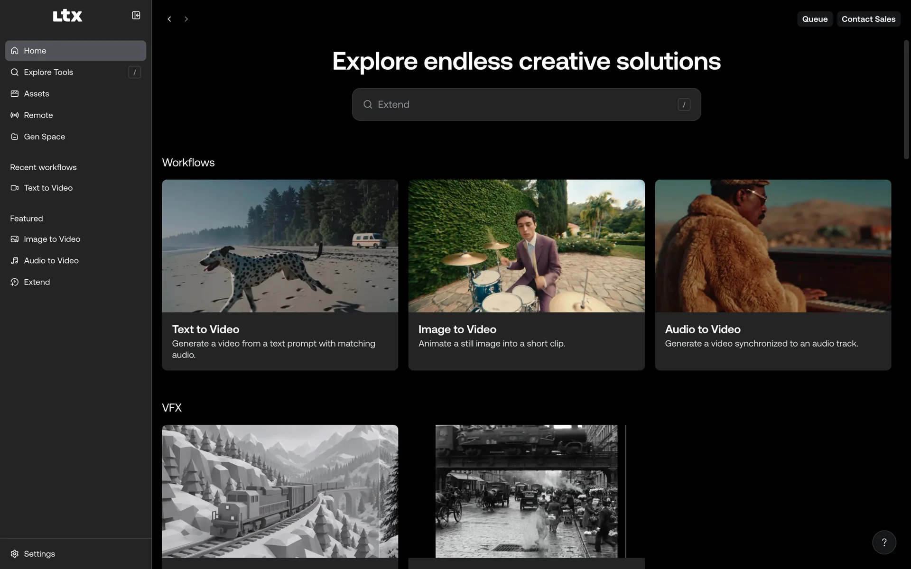
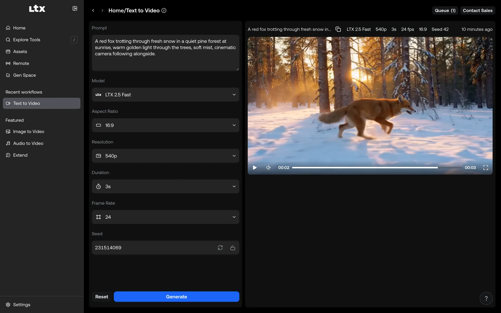
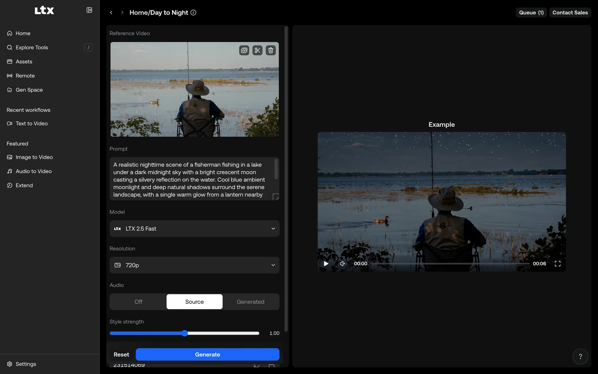
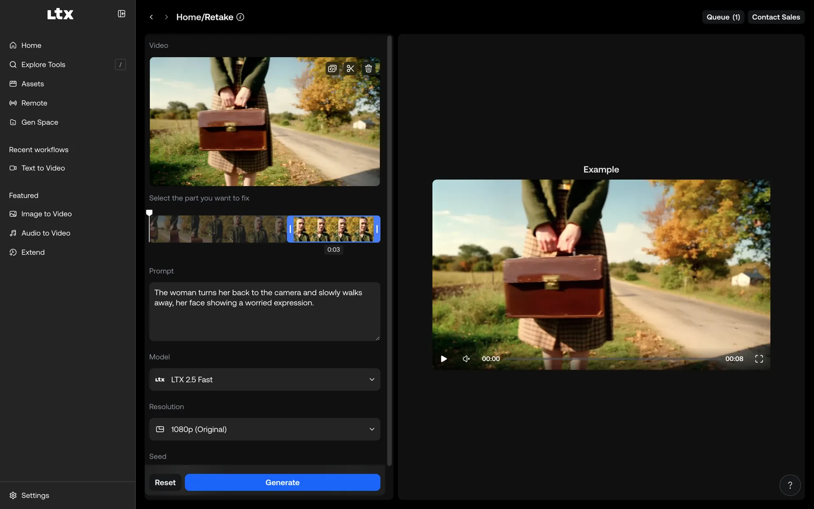
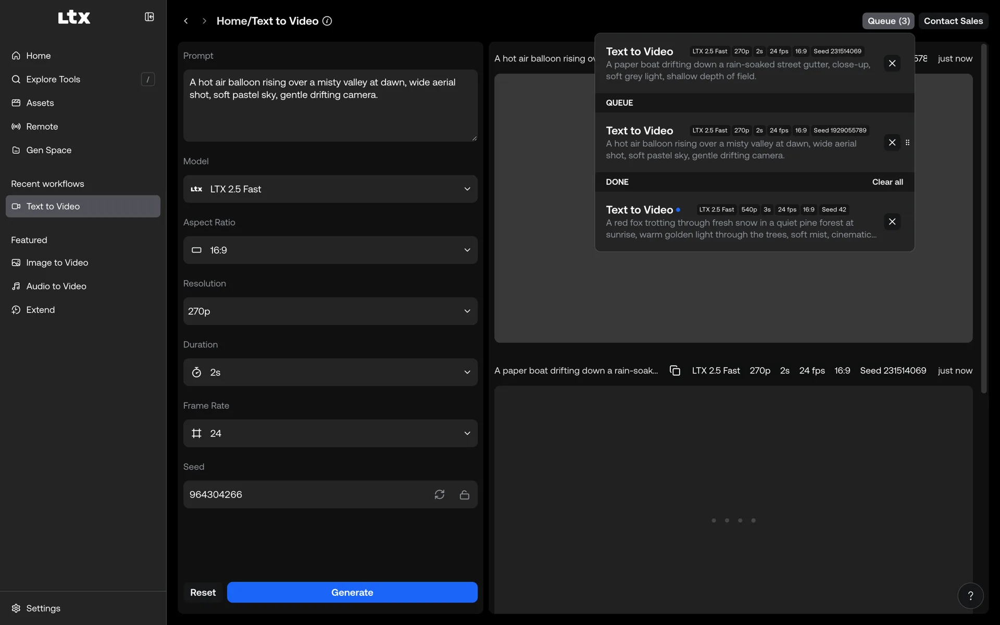
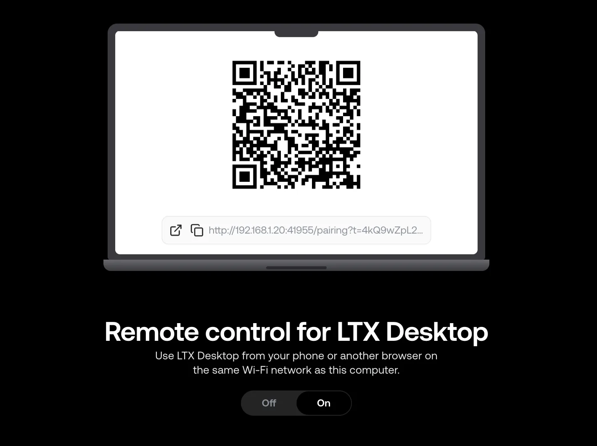
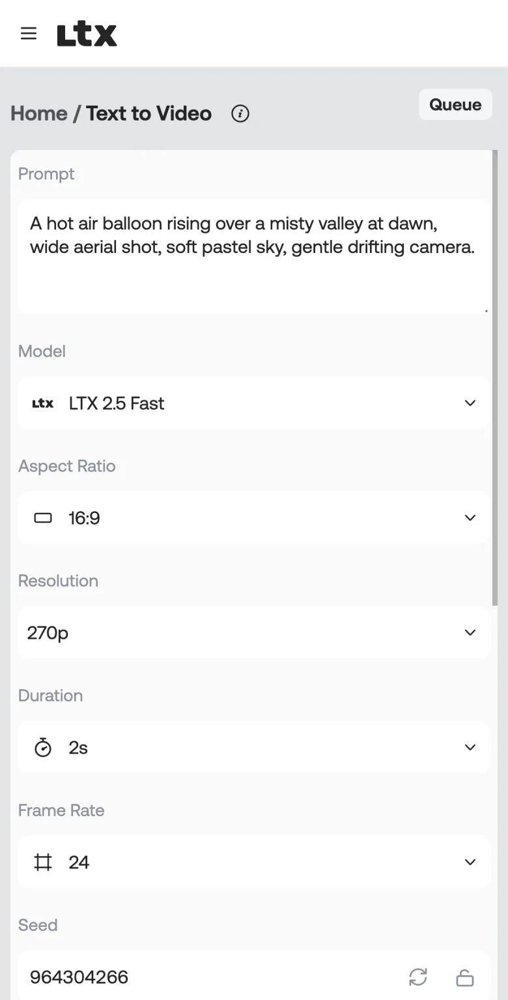
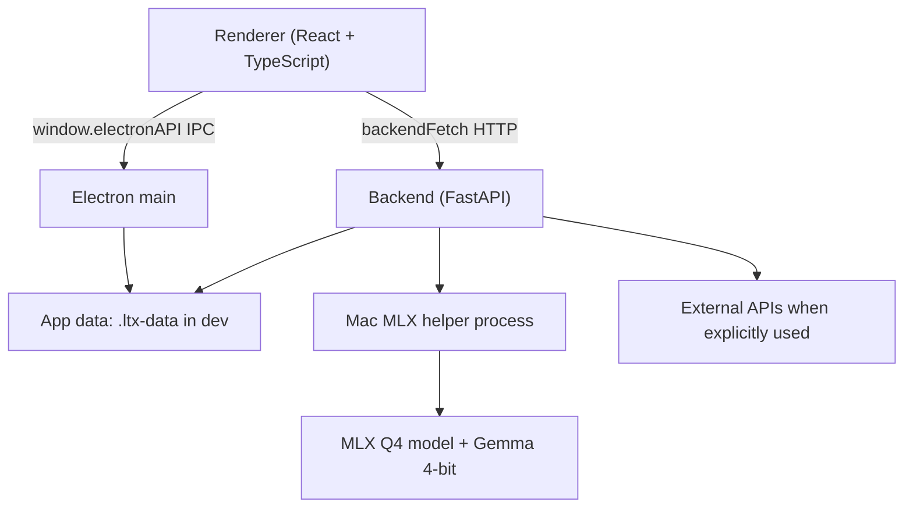

# LTX Desktop Mac Local Fork (no api needed)

This fork of [Lightricks/LTX-Desktop](https://github.com/Lightricks/LTX-Desktop)
adds a first working Apple Silicon local-generation path using MLX and the
compact Q4 LTX 2.3 model. It is intended to run locally on a Mac with about
36 GB of unified memory while keeping the original LTX API mode available.

> Status: working first milestone. Text-to-video runs locally through the MLX Q4
> path, with 720p 10-second generation confirmed working on the 36 GB target Mac.
> Local image-to-video uses a deterministic still-motion fallback because the
> current MLX Q4 distilled I2V path collapses into tiled artifacts after the
> first frame. The LTX API path remains available for true generative I2V.


## What This Fork Adds

- Local Apple Silicon generation mode: `mac_mlx_q4`.
- Project-local development storage in `.ltx-data/` so model/runtime downloads
  can stay on the external project drive.
- MLX Q4 model support from `dgrauet/ltx-2.3-mlx-q4`.
- MLX 4-bit Gemma text encoder and local prompt enhancement from
  `mlx-community/gemma-3-12b-it-4bit`.
- Prompt Enhancer visibility without requiring an LTX API key.
- A Gen Space scene queue for loading many video prompts and rendering them sequentially overnight.
- A Mac MLX speed control in Settings:
  - `Quality`: exact/default sampler.
  - `Boost`: skips stable middle denoise steps for faster text-to-video renders.
  - `Turbo`: more aggressive, text-to-video only, may add artifacts.
- A setup script: `scripts/setup-mac-mlx.sh`.

[Features](#features) | [Download](#install) | [System requirements](#system-requirements) | [Guides](#guides) | [FAQ](https://ltx.io/ltx-desktop) | [Development](docs/DEVELOPMENT.md)

LTX Desktop is an open-source desktop app for AI video generation with LTX models. It runs locally on supported Windows and Linux NVIDIA GPUs and on Apple Silicon Macs. Generation runs on your own hardware. Prompts and media leave your computer only when you use an optional cloud feature, such as API text encoding or Gemini prompt enhancement.

> **Status: Beta.** Expect breaking changes.
> Frontend architecture is under active refactor. Large UI PRs may be declined for now (see [`CONTRIBUTING.md`](docs/CONTRIBUTING.md)).

<p align="center">
  <picture>
    <source media="(prefers-color-scheme: light)" srcset="images/home-light.webp">
    
  </picture>
</p>

## Supported Local Mac Envelope

Validated target machine: Apple Silicon Mac with 36 GB unified memory.

| Resolution | Local MLX Q4 durations exposed in UI | Current recommendation |
| --- | --- | --- |
| 540p | 5-20 seconds at 24 fps | Good for longer tests |
| 720p | 5-20 seconds at 24 fps | Best default; 10-second clips are confirmed usable on the target Mac |
| 1080p | 5 seconds at 24 fps | 10 seconds can complete, but extended quality still needs more validation |

The app may be able to render beyond these limits if edited manually, but this
fork treats actual viewable quality as the release gate.

## Quick Start On Apple Silicon

Prerequisites:

- macOS 26 or later on Apple Silicon (`arm64`), with at least 32 GB unified memory
- Git
- Node.js and Corepack
- `pnpm`
- `uv`
- Plenty of free space on the project drive. The local data folder can exceed
  50 GB once the MLX runtime, models, caches, and outputs are present.

From the project root:

```bash
corepack enable
pnpm install
scripts/setup-mac-mlx.sh
LTX_APP_DATA_DIR="$PWD/.ltx-data" LTX_MLX_PATH="$PWD/.ltx-data/ltx-2-mlx" pnpm dev
```

The setup script keeps its downloads under `.ltx-data/` by default:

```text
.ltx-data/
  ltx-2-mlx/              # MLX runtime checkout and Python 3.13.12 env
  models/
    ltx-2.3-mlx-q4/
    gemma-3-12b-it-4bit/
  uv-cache/
  hf-home/
  cache/
  outputs/
```

For more detail, see [docs/MAC_LOCAL_MLX.md](docs/MAC_LOCAL_MLX.md).

## Running The App

Development:

```bash
LTX_APP_DATA_DIR="$PWD/.ltx-data" LTX_MLX_PATH="$PWD/.ltx-data/ltx-2-mlx" pnpm dev
```

If `pnpm dev` tries to rerun dependency installation and asks to purge
`node_modules` in a non-interactive shell, launch the already-installed Vite
dev app directly instead:

```bash
LTX_APP_DATA_DIR="$PWD/.ltx-data" LTX_MLX_PATH="$PWD/.ltx-data/ltx-2-mlx" ./node_modules/.bin/vite
```

Project-local launcher script:

```bash
scripts/start-mac-local.sh
```

Install a double-clickable launcher app into `/Applications`:

```bash
scripts/install-mac-launcher-app.sh
```

This creates `/Applications/LTX Desktop Local.app`. It opens Terminal and runs
the project-local launcher so logs remain visible and the app keeps using
`.ltx-data` on the project drive.

TypeScript check:

```bash
pnpm typecheck:ts
```

Focused backend tests used for this fork:

```bash
cd backend
UV_CACHE_DIR=../.ltx-data/uv-cache ../.venv-tools/bin/uv run --extra test python -m pytest \
  tests/test_settings.py \
  tests/test_generation.py::TestEnhancePromptFlag \
  tests/test_model_download_specs.py \
  tests/test_runtime_policy_decision.py \
  tests/test_models.py \
  -q
```

Full upstream checks remain:

```bash
pnpm typecheck
pnpm backend:test
pnpm build:frontend
```

## Scene Queue

In Gen Space video mode, open `Scene Queue` above the prompt bar. Paste one
prompt per line, click `Add`, then click the play button to render the queued
scenes one at a time. Pause stops after the current render finishes. Completed
clips are saved into the active project gallery just like normal generations.

Each queued scene snapshots the current reference images, input image, input
audio, and other generation settings at the moment it is added. The queue panel
exposes a queue-wide resolution selector and a per-scene time selector, so you can
load many prompts, set the global output size, then tune each scene duration
before pressing play. The queue is stored per project in local browser storage;
if the app reloads, any item that was mid-render is returned to `queued`. Use
`Clear all` to remove every row at once; the app asks for confirmation first, and
an already-started render will continue running.

## Data Locations

In development, this fork defaults Electron `userData` to:

```text
<repo>/.ltx-data
```

You can override it:

```bash
export LTX_APP_DATA_DIR="/Volumes/X10Pro4T/projects/ltx-mac/.ltx-data"
```

Packaged app defaults are still OS-standard unless `LTX_APP_DATA_DIR` is set:

The app opens on a gallery of ready-to-use tools. Generations run through one shared queue and land in an Assets library.

- **Video generation.** Text to Video, Image to Video (start frame, optional end frame), and Audio to Video. All run locally.
- **Video editing.** **Retake** regenerates a selected part of a clip. **Extend** adds frames before or after a clip.
- **IC-LoRA tools.** Video-to-video effects such as Day to Night, Deblur, Colorization, Clean Plate, and Layout to Render.
- **LoRA recipes.** One-click styles and camera moves such as Cozy Felt, Claymation, Dolly In, and Jib Up.
- **Prompt enhancement.** Automatic prompt rewriting before local generation. The manual **Enhance** button appears when auto-enhance is off.
- **Generation queue and Assets library.** Reorder or cancel jobs. Generations and assets persist across restarts.
- **Assistant.** A chat that finds your assets and queues local videos, recipes, extensions, and retakes, using the Gemini API or a local Qwen model. See [Assistant](#assistant).
- **Remote.** Use the app from a phone on the same network. See [Remote](#remote).
- **Light and dark themes.** Choose **System** (default), **Light**, or **Dark** in **Settings > General > Appearance**.
- **Deep links.** Open a tool with `ltxdesktop://fetcher/{tool}`, for example `ltxdesktop://fetcher/t2v`. Open the Assets library with `ltxdesktop://assets`.

<p align="center">
  
  
</p>
<p align="center">
  
  
</p>

### Tools

| Section | Tool | Input | What it does |
| --- | --- | --- | --- |
| Workflows | Text to Video | Prompt | Generates a video with matching audio from a text prompt |
| Workflows | Image to Video | Start frame, optional end frame | Animates a still image, or interpolates between two frames |
| Workflows | Audio to Video | Audio (upload or microphone), optional start frame | Generates visuals synchronized to an audio track |
| Post production | Retake | Video | Regenerates a selected part of a clip |
| Post production | Extend | Video | Adds frames before or after a clip |
| Post production, VFX | IC-LoRA tools | Video (and a look image for some) | Effects that keep the motion and framing of the source |
| Styles, Camera & motion | LoRA recipes | Prompt, start frame, or both frames | Styles and camera moves |

Every setting for every tool is in [`docs/tools-and-options.md`](docs/tools-and-options.md).

Looking for Gen Space or the Video Editor? See [`docs/gen-space-and-video-editor.md`](docs/gen-space-and-video-editor.md).

## Install

1. Download the installer for your platform from the [latest release](https://github.com/Lightricks/LTX-Desktop/releases/latest):
   - **Windows (x64):** [`LTX-Desktop-Setup.exe`](https://github.com/Lightricks/LTX-Desktop/releases/latest/download/LTX-Desktop-Setup.exe)
   - **macOS (Apple Silicon):** [`LTX-Desktop-arm64.dmg`](https://github.com/Lightricks/LTX-Desktop/releases/latest/download/LTX-Desktop-arm64.dmg)
   - **Linux (x64):** [`LTX-Desktop-x86_64.AppImage`](https://github.com/Lightricks/LTX-Desktop/releases/latest/download/LTX-Desktop-x86_64.AppImage) or [`LTX-Desktop-amd64.deb`](https://github.com/Lightricks/LTX-Desktop/releases/latest/download/LTX-Desktop-amd64.deb)
   - **Linux (arm64):** [`LTX-Desktop-arm64.AppImage`](https://github.com/Lightricks/LTX-Desktop/releases/latest/download/LTX-Desktop-arm64.AppImage) or [`LTX-Desktop-arm64.deb`](https://github.com/Lightricks/LTX-Desktop/releases/latest/download/LTX-Desktop-arm64.deb)
2. Install and launch **LTX Desktop**.
3. Complete the first-run Setup screen: Hugging Face sign-in (required for gated models such as the 2.5 weights), API keys, and model downloads.

**Updates.** Packaged installs check GitHub Releases for updates at startup and every 4 hours. Automatic checks are on by default. Turn them off in **Settings > About**, where you can also check manually.

- **macOS:** The app downloads an update in the background and installs it when you quit.
- **Windows and Linux:** The app shows a prompt. Download the update, then restart to install it. The app does not restart while a generation runs.

Release notes are on the [GitHub releases page](https://github.com/Lightricks/LTX-Desktop/releases).

### System requirements

These are the requirements for local generation. They match the [LTX Desktop page](https://ltx.io/ltx-desktop).

| Platform | Requirements |
| --- | --- |
| **Windows 10/11** (64-bit) | NVIDIA GPU with CUDA and **24 GB or more VRAM** (32 GB recommended). 32 GB RAM. |
| **Linux** (Ubuntu 22.04+ or similar, x64 or arm64) | NVIDIA GPU with CUDA and **24 GB or more VRAM** (32 GB recommended), NVIDIA driver installed. 32 GB RAM. |
| **macOS 26+** (Tahoe) | Apple Silicon (M1 or later) with **48 GB or more** for full local generation. Apple Silicon with 32 GB is limited to 540p and 5 s. Apple Silicon with less than 24 GB, and Intel Macs, use the Gen Space API only. |

The app itself needs **macOS 14 or later**. On macOS 14 and 15, local generation is not available and the app shows the **Coming soon to your device** notice. macOS 13 and earlier cannot run the app.

All platforms need **100 GB or more** of free disk space. Plan for up to **160 GB or more** if you add LoRAs and IC-LoRAs.

The app offers local generation on lower-spec machines, but we do not recommend them. The app checks 9 GiB VRAM on Windows with an fp8-capable GPU (15 GiB on other CUDA setups), 32 GiB total RAM on macOS, and macOS 26 or later. Below these floors, the app shows a **Coming soon to your device** notice instead of the generation tools. Assets, Settings, Gen Space, and the Video Editor stay available. Cloud APIs are optional. An LTX API key is never required to start.

See [`docs/local-compat-matrix.md`](docs/local-compat-matrix.md) for the tool-by-hardware table.

## Models

- **LTX 2.5 Fast** is the default local model. It runs every tool.
- **LTX 2.3 Fast** is the previous generation. It runs the same tools. Pick it in a tool's **Model** menu.
- **LTX 2.5 Pro** and **2.3 Pro** are API only, in Gen Space and the Video Editor.

The 2.5 weights and some LoRAs are gated on Hugging Face. Manage all models in **Settings > Models**. See [`docs/models-and-loras.md`](docs/models-and-loras.md) for gated models, the LoRA library, and how to add your own LoRAs.

## Assistant

The Assistant is a chat for Explore. Describe what you want ("four 5-second clips of a puffin, claymation style", "extend this to 10 seconds", "make this night") and it queues the jobs on the same local generation queue as Home, then reports the results. Open it from the sidebar, or use **Ask assistant** on an asset to attach it. It also works from a phone over [Remote](#remote).

- **Model:** choose **Gemini API** (uses your Gemini key) or a local **Qwen 3.5 9B** in **Settings > General > Assistant**. Download Qwen in **Settings > Models > Assistant models**; local mode never falls back to the cloud. Desktop and Remote share this one choice; switching model from either composer changes it everywhere.
- **What it can do:** text-, image- and audio-to-video, the Explore style and motion recipes, video recipes such as Day to Night or Restore, extend and retake. Video generation is always local; there is no cloud video tool.
- **What it can't do:** download models, change settings, use your own LoRAs, or place more than a start and end frame. It says so instead of guessing.
- **Privacy:** with Gemini, your messages, the chat history, asset metadata and small thumbnails of attached or viewed assets are sent to Google. Local mode keeps everything on your machine.

See [`docs/desktop-assistant.md`](docs/desktop-assistant.md) for how it works.

## Remote

Remote lets a phone or another computer use the app from a browser on the same network. It uses the same queue, Assets library, and GPU as the desktop app. No generation runs on the phone.

1. Open **Remote** in the sidebar and turn Remote on. The sidebar hides **Remote** when local generation is not available.
2. Scan the QR code with your phone, or copy the link.
3. Open the tools from the phone's home screen. The Remote page on the desktop lists connected devices. You can revoke any device.

<p align="center">
  
  
</p>

For the architecture and API boundary, see [`docs/remote-lan.md`](docs/remote-lan.md).

## Guides

- [`docs/tools-and-options.md`](docs/tools-and-options.md): every tool and setting, and how prompt enhancement works
- [`docs/models-and-loras.md`](docs/models-and-loras.md): models, gated models, LoRA library, custom LoRAs
- [`docs/setup-and-settings.md`](docs/setup-and-settings.md): per-platform requirements, first run, data folders, text encoding, Settings tabs
- [`docs/api-keys-and-privacy.md`](docs/api-keys-and-privacy.md): LTX, fal, and Gemini keys, cost, and privacy
- [`docs/desktop-assistant.md`](docs/desktop-assistant.md): the Assistant's tools, runs, providers, and local runtime
- [`docs/remote-lan.md`](docs/remote-lan.md): Remote architecture and API boundary
- [`docs/gen-space-and-video-editor.md`](docs/gen-space-and-video-editor.md): the original Gen Space and Video Editor interfaces
- [`docs/DEVELOPMENT.md`](docs/DEVELOPMENT.md): architecture, commands, and build steps for developers
- [FAQ](https://ltx.io/ltx-desktop): common questions, on the LTX Desktop page

- macOS: `~/Library/Application Support/LTXDesktop/`
- Windows: `%LOCALAPPDATA%\LTXDesktop\`
- Linux: `$XDG_DATA_HOME/LTXDesktop/` or `~/.local/share/LTXDesktop/`

## API Keys

Local Mac generation does not require the LTX video-generation API.

An LTX API key can still be useful for:

LTX Desktop collects minimal, anonymous usage analytics to help prioritize development. It collects no personal information and no generated content. Analytics is on by default. Turn it off in **Settings > General > Anonymous Analytics**. See [`TELEMETRY.md`](docs/TELEMETRY.md) for the full list of data that the app collects.

## Development (quickstart)

Prerequisites: Node.js, `pnpm`, `uv`, Python 3.12+, and Git.

```bash
pnpm setup:dev   # one-time setup
pnpm dev         # run the app
```

For the architecture, all commands, and build steps, see [`docs/DEVELOPMENT.md`](docs/DEVELOPMENT.md).

- API video generation.
- API-backed cloud text encoding on supported flows.
- API-backed prompt enhancement where configured.
- Retake/API features.

The local Mac MLX flow can use the downloaded Gemma helper for prompt
enhancement without an LTX API key.

Optional keys:

- fal API key: Z Image Turbo text-to-image generation in API mode.
- Gemini API key: AI prompt suggestions.

## Architecture

LTX Desktop has three main layers:

- `frontend/`: React 18 + TypeScript + Tailwind renderer.
- `electron/`: Electron main/preload process, app lifecycle, IPC, Python backend
  process management, and ffmpeg export.
- `backend/`: Python FastAPI server for ML orchestration, model downloads, API
  clients, and local generation services.



Key fork files:

- `backend/runtime_config/runtime_policy.py`: selects `mac_mlx_q4` on Apple
  Silicon with enough memory.
- `backend/runtime_config/model_download_specs.py`: source of truth for exposed
  local model/resolution/duration options.
- `backend/services/fast_video_pipeline/mlx_fast_video_pipeline.py`: backend
  wrapper around the MLX helper process.
- `backend/services/fast_video_pipeline/mlx_warm_helper.py`: long-lived MLX
  helper used for prompt enhancement, text encoding, and rendering.
- `scripts/setup-mac-mlx.sh`: project-local MLX runtime/model setup.
- `frontend/components/SettingsModal.tsx`: prompt enhancer and Mac MLX speed UI.
- `electron/app-paths.ts`: development `.ltx-data` user-data location.

## Documentation

- [Mac Local MLX Runbook](docs/MAC_LOCAL_MLX.md)
- [Installer Build Guide](docs/INSTALLER.md)
- [Telemetry](docs/TELEMETRY.md)
- [Contributing](docs/CONTRIBUTING.md)
- [Backend Architecture](backend/architecture.md)

## Known Limitations

- The updated runtime has passed bounded 512×288 diagnostics. Full 720p/1080p
  render quality, duration, and RAM acceptance remain pending.
- `Boost` and `Turbo` are text-to-video performance/quality tradeoffs.
- Local Mac single-image-to-video uses the dev Q4 model with guided one-stage
  denoising and 30 steps. It requires `transformer-dev.safetensors`; rerun setup
  to download it. Boost/Turbo apply to text-to-video only. A 512×288, 17-frame
  diagnostic passed on the 36 GB M4 Max; 720p/1080p acceptance is still pending.
- The MLX path relies on a project-local `ltx-2-mlx` checkout at version
  `v0.14.0` prepared by `scripts/setup-mac-mlx.sh`; run with
  `LTX_MLX_PATH="$PWD/.ltx-data/ltx-2-mlx"` when starting from a shell.
- The local setup downloads large model/runtime assets that are intentionally
  ignored by Git.

## License

Application code is Apache-2.0; see [LICENSE.txt](LICENSE.txt).

Third-party notices and model terms may apply; see [NOTICES.md](NOTICES.md) and
the model repositories downloaded during setup.

Apache-2.0. See [`LICENSE.txt`](LICENSE.txt).

Third-party notices (including model licenses and terms): [`NOTICES.md`](NOTICES.md).

Model weights are downloaded separately. Additional licenses and terms can apply.
